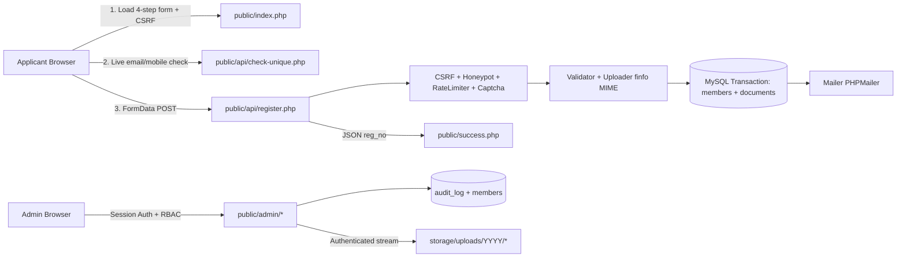

# Council Member Registration Portal

<p align="center">
  <strong>A secure, mobile-first online membership registration and administrative review portal.</strong>
</p>
<p align="center">
  
  
  
  
  
</p>

---
## Overview

The **Council Member Registration Portal** replaces paper and ad-hoc registration workflows with a structured, auditable web application built strictly on **HTML5**, **vanilla JavaScript (ES6 modules, `fetch`)**, **Bootstrap 5.3**, **PHP 8.1+ (PDO)**, and **MySQL 8**. Only two Composer dependencies are used: `phpmailer/phpmailer` and `vlucas/phpdotenv`.

### Key Highlights
- **4-Step Public Registration Wizard:** Responsive from 360 px with progress bar, client + authoritative server-side validation, live email/mobile duplicate detection, `localStorage` draft persistence, image thumbnail preview, and printable acknowledgement (`REG-YYYY-NNNNNN`).
- **Defense-in-Depth Security:** Strict PDO prepared statements, per-session CSRF tokens on every `POST`, `htmlspecialchars` output escaping, `finfo` real-MIME file validation stored outside the web root, dual anti-bot protection (math challenge + honeypot), IP rate limiting, and brute-force login lockout.
**Full Admin Review Console:** Role-based access (`reviewer` & `super_admin`), dashboard metrics, multi-filter search & sortable pagination, authenticated document preview/download, approve/reject workflow with required rejection reasons, UTF-8 BOM CSV export with spreadsheet formula neutralization, and an append-only audit log.

---

## Architecture & Request Flow



### Folder Structure

```text
council-portal/
├── public/                        # Web server DocumentRoot (only web-accessible folder)
│   ├── index.php                  # 4-step public registration entry point
│   ├── success.php                # Printable registration acknowledgement page
│   ├── api/
│   │   ├── register.php           # JSON POST registration endpoint
│   │   └── check-unique.php       # Live email/mobile duplicate check API
│   ├── admin/
│   │   ├── login.php              # Admin authentication + 5-attempt lockout
│   │   ├── logout.php             # CSRF-protected session termination
│   │   ├── change-password.php    # Mandatory first-login & self-service password update
│   │   ├── dashboard.php          # Status count cards & recent registrations
│   │   ├── members.php            # Search, status/category/date filters, sort, pagination
│   │   ├── member.php             # Applicant details, inline edit, document preview, approve/reject
│   │   ├── export.php             # Filtered UTF-8 BOM CSV export (formula-safe)
│   │   ├── file.php               # Authenticated document streamer from storage/
│   │   ├── categories.php         # Category management (super_admin only)
│   │   ├── admins.php             # Admin & role management (super_admin only)
│   │   └── audit.php              # Immutable audit log viewer (super_admin only)
│   └── assets/
│       ├── css/custom.css         # Design tokens (#1f4e79 navy, #c8963e gold, print & mobile styles)
│       ├── img/logo.svg           # Council emblem placeholder
│       └── js/
│           ├── register.js        # Stepper, draft persistence, upload preview, fetch submit
│           ├── validators.js      # Client-side rules mirroring Validator.php
│           ├── success.js         # Acknowledgement print trigger
│           └── admin.js           # Edit panel toggle & decision validation
├── app/                           # Protected application core (.htaccess deny-all)
│   ├── bootstrap.php              # Autoloader, .env, security headers, hardened sessions, logging
│   ├── config/ (app.php, db.php)
│   ├── controllers/ (RegisterController.php, AdminController.php)
│   ├── models/ (Member.php, Admin.php, Category.php, AuditLog.php)
│   ├── services/ (Database.php, Validator.php, Uploader.php, Mailer.php, Csrf.php, Captcha.php, RateLimiter.php, Auth.php)
│   └── views/ (register_form.php, partials/)
├── storage/                       # Outside web root (.htaccess deny-all)
│   ├── uploads/                   # Year-partitioned random-named uploads (YYYY/<32hex>.ext)
│   └── logs/                      # app.log, php_errors.log, mail.log
├── database/
│   ├── schema.sql                 # Full MySQL 8 / MariaDB schema (utf8mb4, InnoDB)
│   ├── seed.sql                   # 9 categories (8 active, 1 archived) + seeded super_admin
│   └── migrations/001_initial_schema.sql
├── docs/                          # Complete PRD, rules, architecture, design, phases, test plan, memory
├── tests/
│   ├── router.php                 # Dev router for PHP built-in server enforcing .htaccess rules
│   ├── smoke-test.sh              # Curl-based smoke test script
│   ├── sql-checks.sql             # Schema, constraints, indexes, and EXPLAIN plan checks
│   └── phase1-checks.php .. phase4-security-checks.php
├── .env.example
├── .gitignore
└── composer.json
```

---

## Tech Stack

| Layer | Technology | Notes |
| --- | --- | --- |
| **Frontend** | HTML5, Vanilla JS (ES6 modules), Bootstrap 5.3 | No jQuery, no frontend framework, no build step |
| **Backend** | PHP 8.1+ (`strict_types=1`, PDO) | Layered MVC-style services & models, no framework |
| **Database** | MySQL 8.0+ / MariaDB 10.4+ (`InnoDB`, `utf8mb4`) | Prepared statements + DB-level `UNIQUE` & FK constraints |
| **Dependencies** | `phpmailer/phpmailer`, `vlucas/phpdotenv` | Installed via Composer |

---

## Database Schema

| Table | Purpose | Key Constraints |
| --- | --- | --- |
| `categories` | Council membership categories | `UNIQUE (code)`, `is_active` flag |
| `members` | Applicant profiles & review state | `UNIQUE (reg_no)`, `UNIQUE (email)`, `UNIQUE (mobile)`, `INDEX (status, created_at)` |
| `documents` | Uploaded photo & ID proof metadata | `FK (member_id) -> members(id) ON DELETE CASCADE`, `UNIQUE (member_id, doc_type)` |
| `admins` | Reviewer & Super Admin accounts | `UNIQUE (username)`, `UNIQUE (email)`, `role`, `must_change_password` |
| `audit_log` | Append-only record of admin & auth actions | `FK (admin_id) ON DELETE SET NULL` |
| `login_attempts` | Per-IP/account brute-force lockout tracking | `UNIQUE (ip_address, identifier)` |
| `rate_limits` | Sliding-window API rate limits | `UNIQUE (key_hash, action)` |

---

## Local Setup & Quick Start

### 1. Prerequisites
- **PHP 8.1+** with `pdo_mysql`, `fileinfo`, `mbstring`, and `openssl` extensions enabled
- **MySQL 8.0+** or **MariaDB 10.4+**
- **Composer**

### 2. Install & Configure

```bash
git clone <your-repo-url>
cd council-portal

# Install Composer packages
composer install --no-dev --optimize-autoloader

# Create environment file
cp .env.example .env
```

Update `.env` with your local database and optional SMTP credentials:

```env
APP_ENV=local
APP_URL=http://127.0.0.1:8000
APP_DEBUG=false
APP_TIMEZONE=Asia/Kolkata
COUNCIL_NAME="National Civic & Professional Council"

DB_HOST=127.0.0.1
DB_PORT=3306
DB_NAME=council_portal
DB_USER=root
DB_PASS=
```

### 3. Import Database Schema & Seed Data

```bash
mysql -u root -p < database/schema.sql
mysql -u root -p council_portal < database/seed.sql
```

### 4. Start the Server

```bash
php -S 127.0.0.1:8000 -t public tests/router.php
```

- **Public Registration Form:** `http://127.0.0.1:8000/`
- **Admin Login:** `http://127.0.0.1:8000/admin/login.php`

---

## Admin Guide

Default seeded Super Admin (`database/seed.sql`):
- **Username:** `admin` (or `admin@councilportal.local`)
- **Temporary Password:** `Admin@1234`

> **Mandatory First Login:** `must_change_password` is enabled on the seeded account. Upon signing in, you are automatically redirected to `/admin/change-password.php` to set a new strong password (minimum 8 characters with uppercase, lowercase, and a digit).

### Roles
- **Reviewer (`reviewer`):** Accesses Dashboard, Members list, Member detail/edit, Approve/Reject decisions, Document downloads, and CSV Export. Receives `403 Forbidden` on Super Admin routes.
- **Super Admin (`super_admin`):** Full Reviewer access plus Category management (`/admin/categories.php`), Admin user/role management (`/admin/admins.php`, protected against deactivating the last active Super Admin), and Audit Log viewer (`/admin/audit.php`).

---

## Verification & Test Suite

The project includes automated PHP/curl/SQL test scripts under `tests/`:

```bash
# 1. PHP syntax check across all application files
find app public tests -name "*.php" -print0 | xargs -0 -n1 php -l

# 2. Database constraints, Unicode, and core service checks
php tests/phase1-checks.php

# 3. SQL schema, FK cascade, and EXPLAIN index usage checks
mysql -u root -p council_portal < tests/sql-checks.sql

# 4. End-to-end curl smoke test (with server running on port 8000)
BASE_URL=http://127.0.0.1:8000 bash tests/smoke-test.sh

# 5. Dependency vulnerability check
composer audit
```

### Test Coverage Summary (see `docs/test.md`)

| Phase | Cases Run | Passed | Failed | Static-Verified |
| --- | :---: | :---: | :---: | :---: |
| 0 Setup | 6 | 6 | 0 | 1 |
| 1 Foundation | 18 | 18 | 0 | 0 |
| 2 Public Registration | 55 | 55 | 0 | 27 |
| 3 Admin Panel | 39 | 39 | 0 | 11 |
| 4 Hardening & Launch | 23 | 23 | 0 | 35 |

---

## Security Self-Audit

| Check | Evidence | Result |
| --- | --- | --- |
| **Prepared statements only** | All database queries in `app/models/` and `app/services/` use PDO `prepare()` / `execute()` with bound parameters; `SEC-01` scan clean | PASS |
| **Output escaping** | `e()` (`htmlspecialchars($v, ENT_QUOTES, 'UTF-8')`) applied across all views and error outputs; `SVC-05`, `MEM-01`, `SEC-03` passed | PASS |
| **CSRF on every POST** | `Csrf::validateRequest()` enforced on `/api/register.php`, `login.php`, `logout.php`, `change-password.php`, `member.php`, `categories.php`, `admins.php` | PASS |
| **Upload validation** | `Uploader::process()` enforces jpg/png/pdf whitelist, `finfo` real MIME verification, 2 MB cap, random filenames outside `public/`, authenticated `admin/file.php` | PASS |
| **Password hashing** | `password_hash(..., PASSWORD_BCRYPT, ['cost' => 12])` and `password_verify()` with constant-time dummy verification for unknown accounts | PASS |
| **Session hardening** | `session_regenerate_id(true)` on login, `HttpOnly`, `SameSite=Lax`, `Secure` (HTTPS), `use_strict_mode=1`, idle timeout | PASS |
| **Rate limiting & lockout** | `RateLimiter` DB sliding windows on registration & live lookup; `login_attempts` locks after 5 consecutive failures | PASS |
| **No secrets in repo** | `.env`, `vendor/`, `storage/uploads/*`, and `*.log` excluded via `.gitignore`; `.env.example` holds placeholders only | PASS |
| **Errors hidden in production** | `display_errors=0` when `APP_ENV=production` or `APP_DEBUG=false`; unhandled exceptions log to `storage/logs/app.log` | PASS |

---

## Production Deployment & Backup

1. **Document Root:** Point Apache/Nginx `DocumentRoot` strictly to `/path/to/council-portal/public`. Never expose `app/`, `storage/`, `database/`, `vendor/`, or `.env`.
2. **Environment Flags:** Set `APP_ENV=production` and `APP_DEBUG=false` in `.env`, and configure real SMTP credentials (`MAIL_ENABLED=true`).
3. **HTTPS & Cookies:** Serve over TLS/HTTPS; `bootstrap.php` automatically enables `session.cookie_secure=1` on HTTPS.
4. **Permissions:** Set `storage/uploads/` and `storage/logs/` to `0750` (directories) and `0640` (files) owned by the web server user — never `777`.
5. **Branding:** Customize `COUNCIL_NAME` in `.env` and replace `public/assets/img/logo.svg` with your official council crest.
6. **Automated Backup & Restore:**
   ```bash
   # Daily mysqldump cron with 30-day retention
   0 2 * * * mysqldump --single-transaction -u backup_user -p'...' council_portal | gzip > /backups/council_portal_$(date +\%F).sql.gz
   0 3 * * * find /backups -name "council_portal_*.sql.gz" -mtime +30 -delete

   # Restore into a fresh database
   gunzip -c /backups/council_portal_2026-11-12.sql.gz | mysql -u root -p council_portal
   ```
